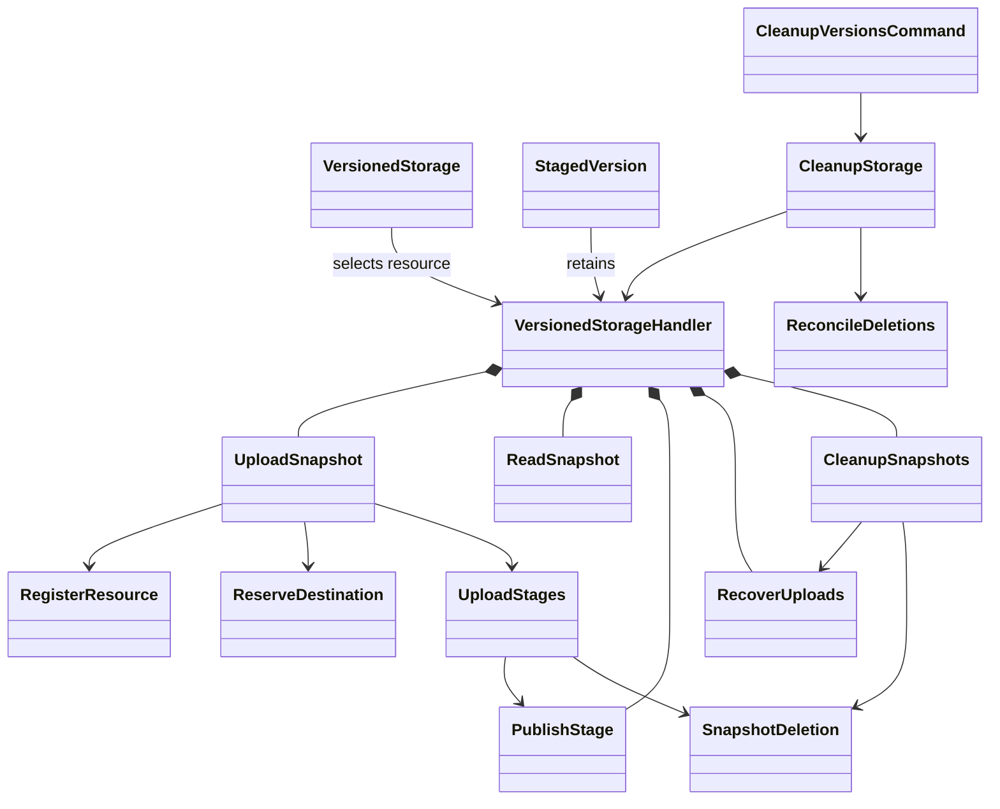
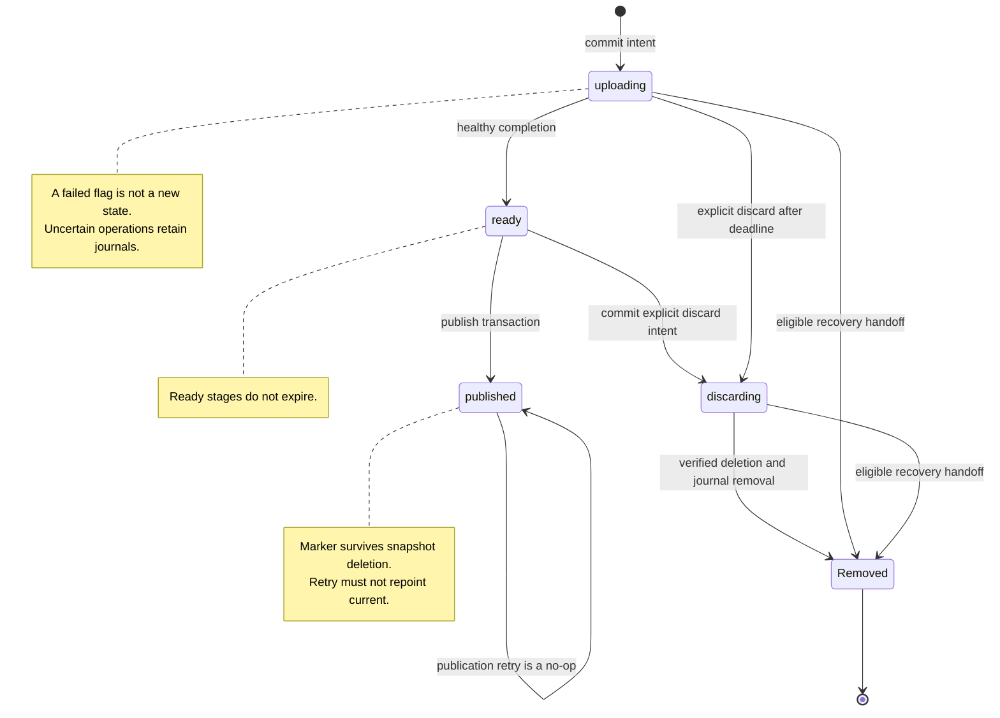
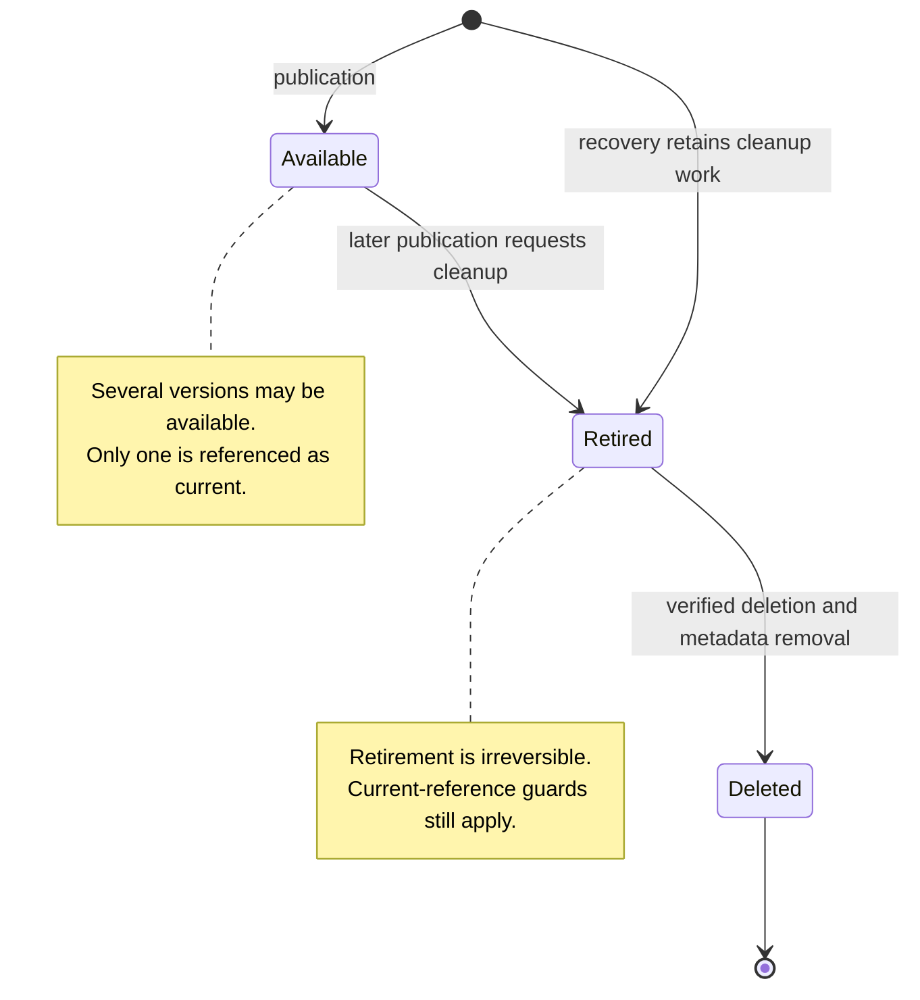
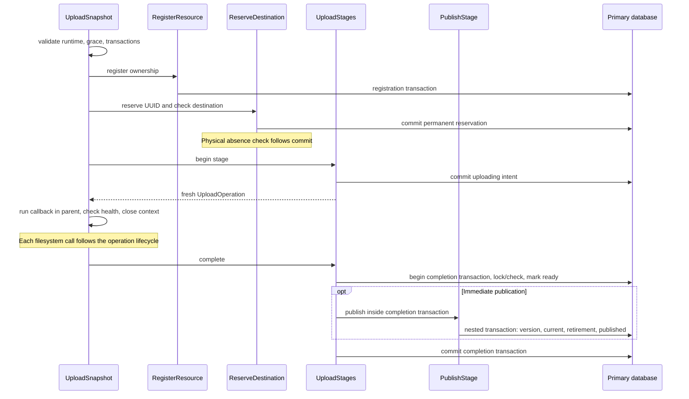
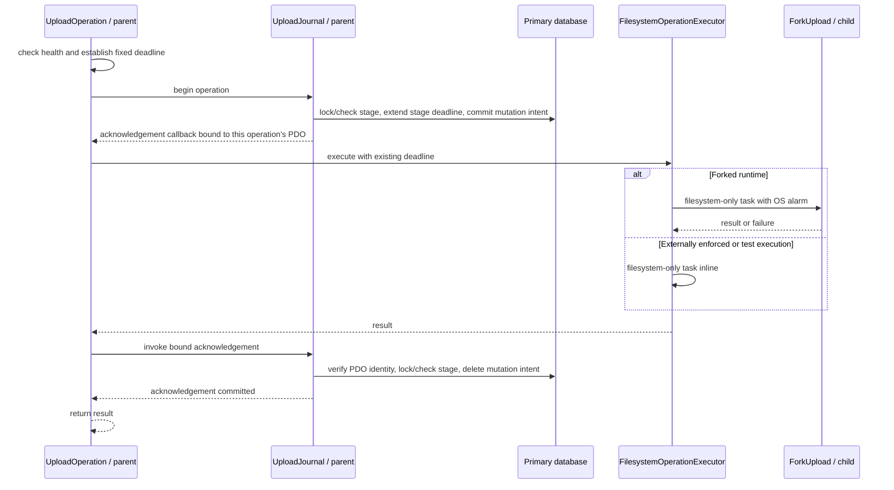
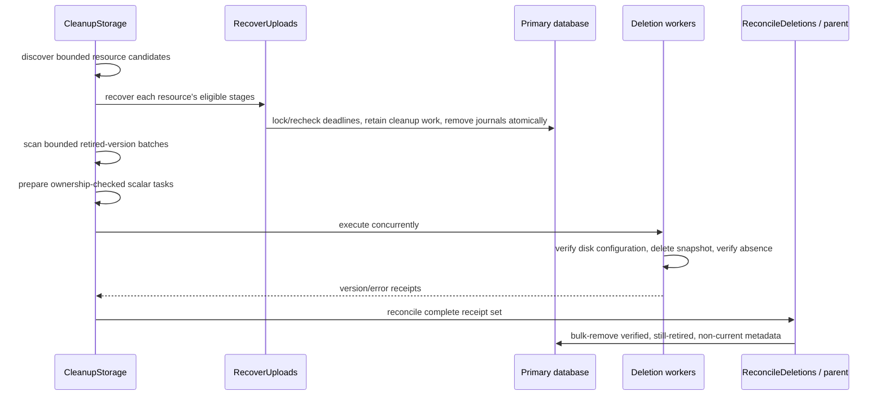

# Implementation architecture

**Using the package in a Laravel application? Start with
[application workflows and guarantees](workflows.md).** It explains writing,
reading, replacement, staging, discard, cleanup, and deletion limitations without
requiring knowledge of these classes.

This document maps those consumer workflows to their implementation and safety
boundaries. It is an implementation reference, not the application getting-started guide.

Read the implementation as **entry point → workflow → mechanism**.
There are three resource workflows: writing, reading, and cleanup. Ordinary steps
are named methods, not separate classes. A separate component owns a cohesive
contract such as stage persistence or physical deletion, not just one line in a
sequence. There is no pipeline engine, step registry, or service locator.

Guards, locks, and atomic updates stay together. Neither a method call nor a
component boundary implies a transaction commit.

## Architectural responsibilities

Directories describe **what the code owns and why it exists**, not phases in
a lifecycle. Lifecycle means the steps, instance lifetime, and failure handling
documented inside each class.

| Directory | What it owns | Why it is separate |
| --- | --- | --- |
| [Actions/](../src/Actions) | Business decisions and ordered steps, including stage transitions, publication, recovery eligibility, and cleanup | Read application intent here without following driver or process-supervision details |
| [Database/](../src/Database) | Shared metadata queries, database locks, transaction recovery, and durable operation journals | Multiple processes need authoritative coordination and recovery records that survive PHP objects |
| [Filesystem/](../src/Filesystem) | Snapshot view construction, filesystem ownership, and verified physical deletion | Protect physical snapshot contents without owning metadata state transitions |
| [Filesystem/Adapters/](../src/Filesystem/Adapters) | Laravel and Flysystem wrappers that scope paths and route callback operations | Keep filesystem integration wrappers discoverable together; reuse framework contracts |
| [Filesystem/Execution/](../src/Filesystem/Execution) | Operation coordination, deadlines, execution, and child-process supervision | Bound individual filesystem operations, not upload callbacks or database work |
| [Filesystem/Execution/Contracts/](../src/Filesystem/Execution/Contracts) | The execution-policy interface | Keep the replacement boundary with the subsystem that uses it |
| [Filesystem/Execution/Policies/](../src/Filesystem/Execution/Policies) | Runtime-context and synchronous-testing execution policies | Group interchangeable implementations beside their shared contract |
| [Console/Commands/](../src/Console/Commands) | Command input, error reporting, and exit status | Adapt Laravel's console to the cleanup action |
| [Facades/](../src/Facades) | Laravel facade | Expose the consumer entry point through Laravel's facade mechanism |
| [Testing/](../src/Testing) | Application test helpers that select and restore execution policy | Applications can test real storage behavior without replacing journals or business rules |

These are responsibility boundaries, not a generic layering framework. Actions
keep their business-specific atomic updates; database helpers own reusable
persistence mechanisms. Filesystem operations may invoke journal callbacks, but
do not own SQL or decide publication, retirement, or recovery eligibility.

[ResourceMetadata](../src/Database/ResourceMetadata.php) provides the resource,
version, and stage queries for one captured connection/resource. Its explicit
`lockResource()` and `lockStage()` methods retain their separate locking rules;
calling actions own transaction boundaries and state transitions.

The filesystem execution classes exist to enforce operation deadlines and
supervise child processes, not to implement another upload workflow. The database
journal records whether an operation finished safely; the action decides what
that means for the snapshot.

A "resource" in metadata means one logical file or directory on a named disk.
[ResourceIdentity](../src/ResourceIdentity.php) carries that disk/path/kind.
It lives at the source root because both metadata and filesystem code use this
shared immutable identity; it performs no IO and is not an additional application
service consumers must construct.

The framework integration directories follow Laravel conventions. `Actions/`
is a common package organization, not a Laravel-required pipeline or base class.

## 1. Entry points

- [VersionedStorage](../src/VersionedStorage.php) adapts consumer inputs and selects
  a resource handler. File streams are opened and closed in the parent callback.
- [VersionedStorageHandler](../src/VersionedStorageHandler.php) constructs the
  resource's shared mechanisms and delegates to the workflows below.
- [StagedVersion](../src/StagedVersion.php) retains its original handler and UUID.
  It does not cache whether the stage is ready, published, or discarded.
- [CleanupVersionsCommand](../src/Console/Commands/CleanupVersionsCommand.php)
  validates console input and transaction state, invokes cleanup, and reports errors.

Composition arrows describe PHP objects, **not** database or snapshot ownership.
The handler constructor is the composition root; it does not resolve workflows
through container lookups.

## 2. The three resource workflows

Start at the public methods of these classes. Their bodies show the order of
work; private methods explain local steps. Class PHPDoc documents responsibility,
lifetime, failure behavior, and which work belongs to collaborators.

| Workflow | Top-down flow | Transaction boundary |
| --- | --- | --- |
| [UploadSnapshot::stage()](../src/Actions/UploadSnapshot.php) | Validate execution → register resource → reserve destination → begin stage → run/close callback → complete; on failure, close and fail stage | Reservation and stage intent commit before callback IO; completion owns a separate transaction |
| [ReadSnapshot](../src/Actions/ReadSnapshot.php) | `get()` / `exists()`: lock resource → resolve readable version → access snapshot. `versions()`: query readable identifiers | Reads hold locks through filesystem access; listing adds no transaction |
| [CleanupSnapshots](../src/Actions/CleanupSnapshots.php) | `cleanup()`: recover → select retired versions → delete each eligible snapshot. `discard()`: mark intent → delete/reconcile stage | Cleanup rechecks each version in its transaction; discard deliberately uses two separate transactions |

`write()` is upload with immediate publication. `stage()` returns a handle for
later publication or discard. Reloading a handle is a small primary lookup in
`VersionedStorage::staged()`; it does not restart writes.

### Why the other components exist

| Component | Cohesive responsibility |
| --- | --- |
| [RegisterResource](../src/Actions/RegisterResource.php) | Establish resource ownership under the registration lock, with overlap policy supplied by ResourceOwnership |
| [ReserveDestination](../src/Actions/ReserveDestination.php) | Capture disk configuration, permanently reserve a UUID, and supervise the physical absence check |
| [UploadStages](../src/Actions/UploadStages.php) | Persist upload intent, completion, and failure; preserve uncertain journals and nested immediate publication |
| [PublishStage](../src/Actions/PublishStage.php) | Atomically publish, select current, and optionally retire history; preserve idempotent retries |
| [RecoverUploads](../src/Actions/RecoverUploads.php) | Discover and atomically reclaim abandoned stage ownership without deleting files |
| [SnapshotDeletion](../src/Filesystem/SnapshotDeletion.php) | Ownership-checked physical deletion, either in the parent or as a scalar-only worker task |
| [CleanupStorage](../src/Actions/CleanupStorage.php) | Run recovery and bounded deletion batches across resources, continuing after reported failures |
| [ReconcileDeletions](../src/Actions/ReconcileDeletions.php) | Validate a complete worker receipt set before guarded metadata acknowledgement |

These are not application services to configure individually. The handler
constructs the resource-scoped graph once; the command constructs global cleanup
per invocation. Resource cleanup is sequential; command workers may delete
independent snapshots concurrently.

## 3. Durable state is not object lifetime

Stage rows, version rows, operation rows, and UUID reservations have different
lifetimes. Do not model them as a single `Snapshot` object with one mutable state.

### Stage journal

`Removed` means the stage row is absent, not a stored state value. A recovery
handoff first retains pending-delete version metadata in the same transaction.
Unlike explicit discard, recovery does not physically delete the snapshot.

### Version visibility and physical retention

These are conceptual version states: retirement is stored as `pending_delete`,
and `Deleted` means the version row is absent. UUID reservations remain permanently.

## 4. Upload and operation boundaries

After `UploadStages::begin()` returns, `UploadSnapshot::runCallback()` owns context
closure in a `finally` block. Every callback exit closes the context before
completion or failure reconciliation. Callback or completion failures invoke
`UploadStages::fail()`. This method
protects committed versions, marks uploading intent failed, and only attempts
physical deletion when no uncertain operation remains. It preserves recovery
journals. Deletion failure reports the original error and propagates the deletion
error instead.

Read operations check/lock the stage and extend its deadline but do not insert
mutation records. A successful begin returns its acknowledgement with the established
PDO captured by value, rather than sharing a nullable tracker between callbacks.
Failed execution never invokes the acknowledgement. Operations within a callback are sequential; each gets a fresh
deadline, while callback failure/closed state is shared. Stage deadlines only
extend. Per-operation deadlines, whole-second rounding, and fork margins do not
change during execution. Callback duration is not bounded by the operation timeout.

The callback context receives its executor and clock explicitly; it does not
resolve services while performing an operation. The executor receives the fork
supervisor and filesystem manager. Runtime policy receives configuration and
reads it afresh on admission. These native dependency boundaries allow isolated
decision tests without starting Laravel; journal persistence and real process
enforcement remain separate Feature and Integration proofs.

## 5. Cleanup eligibility and physical deletion are separate

`CleanupSnapshots` owns the resource workflow and atomic eligibility checks.
Discard's `markDiscarding()` and `deleteDiscarding()` are methods, not objects:
the first transaction must commit before the second starts. `deleteRetired()`
instead checks current/retirement and removes the version record around deletion
within one transaction.

`RecoverUploads` owns bounded discovery, locked deadline rechecks, and the durable
handoff to pending-delete metadata. It does not remove physical files.

`SnapshotDeletion` owns physical removal, not eligibility. `delete()` checks
ownership using the caller's transaction; `prepare()` checks ownership before
dispatching a scalar-only closure. Both use `remove()`, the database-free
filesystem primitive that verifies absence. The cleanup workflow owns metadata
removal after verified deletion.

Synchronous cleanup retains the resource lock through deletion. Worker cleanup
instead relies on **committed, irreversible retirement**: publication has already
waited for protected readers. The parent still checks ownership before preparation
and rechecks retirement/current references when reconciling.

Missing/duplicate/unexpected receipts retain the entire batch's metadata. Reported
worker errors retain their corresponding records; verified successes may be removed.
Resource cleanup reports each deletion failure, continues, and rethrows the first.
Command cleanup reports failures and continues later resources/batches before
returning a failing exit code. Recovery failures never authorize early deletion.

## 6. Object and dependency lifetimes

| Scope | Objects | State and ownership |
| --- | --- | --- |
| Application | [UploadContext](../src/Filesystem/Execution/Policies/UploadContext.php) | Nested worker/job context, maintained by Laravel events; no resource state |
| Handler | Workflows and mechanisms, [ResourceIdentity](../src/ResourceIdentity.php), [ResourceMetadata](../src/Database/ResourceMetadata.php), [ResourceOwnership](../src/Filesystem/ResourceOwnership.php), [SnapshotFilesystem](../src/Filesystem/SnapshotFilesystem.php), [UploadJournal](../src/Database/UploadJournal.php) | Shared captured connection/adapter and immutable identity; no cached records or eligibility |
| Callback | [UploadOperation](../src/Filesystem/Execution/UploadOperation.php) and callback filesystem view | Sticky health and closed state; independent for every stage |
| Filesystem operation | [UploadDeadline](../src/Filesystem/Execution/UploadDeadline.php), UUID, temporary stream buffers | Fixed deadline and operation-local resources; no shared parallel writes |
| Command invocation | CleanupStorage and ReconcileDeletions | Fresh bounded scan and result maps; never serialized into workers |
| Worker task | Scalar disk/path/version/configuration fingerprint | Reconstructed filesystem only; no connection, journal, or lifecycle service |
| Durable storage | Stage/operation/version rows and UUID reservations | Outlive PHP objects; later handlers can resume publication or recover eligible failures |

There are no circular dependencies, destructors, background object-owned
services, or start/stop protocols. [MetadataTransaction](../src/Database/MetadataTransaction.php)
owns transaction recovery, not workflow boundaries. Resource/stage locks remain
database-backed, including SQLite write promotion and supported skip-locked reads.
Locks are transaction-scoped, not tied to an action object's lifetime.

## 7. Testing the architecture

Test cohesive mechanisms directly and workflows through their real metadata and
filesystem effects. Do not expose private steps just to test them. Examples:

- [ResourceMetadataTest](../tests/Feature/Database/ResourceMetadataTest.php): independent
  registration, idempotency, and overlap rejection without upload side effects;
  resource-scoped metadata locks, fresh reads, and caller-owned transaction rollback.
- [UploadLifecycleActionsTest](../tests/Feature/Uploads/UploadLifecycleActionsTest.php):
  admission, permanent reservations, durable intent, callback closure, atomic
  completion/publication rollback, protected reads, and uncertain-write retention.
- [ReclamationActionsTest](../tests/Feature/Recovery/ReclamationActionsTest.php):
  committed discard intent surviving failure, deadline/readiness rechecks, durable handoff, deletion, and
  complete worker-receipt validation.
- [BatchCleanupActionsTest](../tests/Feature/Recovery/BatchCleanupActionsTest.php):
  resource recovery, batch deletion continuing after recovery errors, and
  final current-version protection during reconciliation.
- [HandlerLifecycleTest](../tests/Integration/PublicApi/HandlerLifecycleTest.php): captured
  connection/adapter identity and interleaved stage lifetimes.
- [PublicationTest](../tests/Integration/Concurrency/PublicationTest.php):
  actual simultaneous upload processes and competing publication attempts.

Keep the existing crash, reader-protection, transaction-failure, fork, and real FPM
tests. Isolated mechanism tests do not replace process-termination or concurrency tests.
SQLite tests do not establish MySQL/PostgreSQL-specific locking guarantees; those
require corresponding database integration environments.
