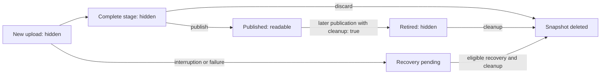

# Using versioned files and folders

This guide describes what your Laravel application does, what readers see, and
what remains on storage. You do not need to construct lifecycle actions or know
the internal classes. Start with the [installation and runtime setup](../README.md#installation).

## The mental model

Think of a resource as a **named collection of immutable snapshots**, not a file
that gets overwritten:

- A **resource** is a logical path on a named disk, used consistently as either
  a file or a directory. For example, `reports/daily.csv` on `s3`.
- A **version** is one complete snapshot with its own UUID and physical location.
  Writing again creates another version; it does not edit the previous one.
- **Current** is the database reference used when you read without a UUID.
  Publishing changes this reference. Other published versions remain readable
  unless you retire them.

Three different operations are important:

| Term | What it means |
| --- | --- |
| Publish | Make a complete snapshot readable and select it as current. |
| Retire | Make an older published snapshot unreadable and eligible for deletion. Its files may still exist. |
| Discard | Abandon an unpublished snapshot and attempt to delete its files. |

**Cleanup physically deletes eligible snapshots; it does not decide which
published history you no longer want.** You make that decision when publishing
a replacement with `cleanup: true`.

Visibility here means visibility through the package API, not access control on
the storage provider. Use private storage for sensitive contents and enforce
your application's download authorization.

## Choose your workflow

All PHP examples use:

```php
use Illuminate\Filesystem\FilesystemAdapter;
use Illuminate\Support\Facades\DB;
use Illuminate\Support\Facades\Schedule;
use SkyRaptor\LaravelVersionedStorage\VersionedStorage;
```

| I want to... | Use | Result |
| --- | --- | --- |
| Write a file now | `VersionedStorage::put(...)` | A new published version UUID. |
| Write a folder now | `VersionedStorage::directory($path, $callback)` | A new published snapshot UUID. |
| Read a file or folder | `get()` / `exists()`, optionally with a UUID | Current or explicitly selected published contents. |
| Keep history | Leave `cleanup` at its default, `false` | Earlier published versions stay readable. |
| Replace and remove old history | Publish with `cleanup: true`, then run cleanup | Earlier versions become hidden first, then physically deleted. |
| Coordinate publication with application data | `stage()` / `stageDirectory()`, then `$stage->publish()` | Upload first; publish in your database transaction. |
| Delete an unpublished upload | `$stage->discard()` | Delete that snapshot without changing current. |
| Recover after a crash or retry deletions | Run `laravel-versioned-storage:cleanup` | Recover eligible interrupted uploads and retry retired snapshots. |
| Delete the current resource or one chosen published version | No supported consumer API currently exists | Neither `cleanup()` nor `discard()` is a resource-delete operation. |

## 1. Write, then read

### A file

```php
$first = VersionedStorage::put('reports/daily.csv', 'first report');
$second = VersionedStorage::put('reports/daily.csv', 'second report');

VersionedStorage::get('reports/daily.csv');         // second report
VersionedStorage::get('reports/daily.csv', $first); // first report
VersionedStorage::versions('reports/daily.csv');   // [$first, $second]
```

Each successful write follows this lifecycle:

1. Reserve a new version location, separate from every previous version.
2. Write the contents while the new version is hidden from package reads.
3. Check that the upload completed successfully.
4. Publish the new version and change current in one metadata transaction.
5. Return the version UUID.

The existing current version remains available while the replacement uploads.
`put()` accepts strings, streams, and Laravel `File` / `UploadedFile` objects.
Without `disk:`, the package uses its configured disk or Laravel's default.
For another disk, pass `disk: 's3'` consistently to writes, reads, and cleanup;
a different disk name identifies a different resource.

The physical file is `reports/daily.csv/<uuid>`. The logical path is an API
identifier, not a file to read with `Storage::get()`. Paths are relative to the
selected disk's root or prefix; do not prepend its configured prefix yourself.

### A folder

```php
$version = VersionedStorage::directory('reports/monthly', function (FilesystemAdapter $files): void {
    $files->put('summary.txt', 'Monthly summary');
    $files->put('details/data.csv', 'Monthly details');
});

$folder = VersionedStorage::directory('reports/monthly');
$folder->get('summary.txt');           // current snapshot
$folder->get('details/data.csv', $version);
$folder->versions();                  // published, non-retired UUIDs
```

The lifecycle is the same, but publication makes the **whole snapshot** available.
Files are stored at `reports/monthly/<uuid>/<child-path>`.

Every callback starts with a new, empty snapshot. Previous files are not copied.
Write every file you want to keep before the callback returns. Keep operations
sequential, use the supplied filesystem, and do not retain it for later work.
Sharing it across parallel workers is unsupported.

### Reading guarantees

- Without a UUID, `get()` / `exists()` select current. With a UUID, they select
  that published version, even if a newer one is current.
- `versions()` lists readable versions oldest first. Uploading, unpublished,
  retired, and deleted snapshots are excluded.
- Missing or retired versions return `false` from `exists()` and throw from
  `get()`. Storage and database failures are not converted into "not found."
- Each package `get()` / `exists()` holds protection until its filesystem
  operation finishes. Retirement waits for these protected readers.
- Separate reads can observe different current versions. Pass the same UUID
  when reading multiple children of one folder. This selects a snapshot but
  **does not reserve it against retirement between calls**; keep history while
  consumers still need it. Download URLs do not have package read protection.

## 2. Replace a snapshot and remove old history

```php
$old = VersionedStorage::put('reports/daily.csv', 'original');
$current = VersionedStorage::put('reports/daily.csv', 'replacement', cleanup: true);

VersionedStorage::exists('reports/daily.csv', $old); // false immediately
VersionedStorage::versions('reports/daily.csv');    // [$current]
VersionedStorage::get('reports/daily.csv');         // replacement

VersionedStorage::cleanup('reports/daily.csv');    // physically delete retired files
```

The two phases are intentional:

1. **At publication commit:** the replacement becomes current and all other
   published versions of this resource become retired, atomically.
2. **During cleanup:** retired snapshots are deleted and their absence verified.
   Failed deletions remain recorded for retry.

`cleanup: true` does not synchronously delete old files. Conversely, `cleanup()`
alone does not retire readable history. With the default `cleanup: false`,
history remains readable indefinitely; there is no automatic age/count policy.
Retirement is irreversible through the public API. The package does not inspect
your application's records for UUID references: do not retire history that
other records, jobs, or download links still need.



This diagram describes application-visible snapshot availability, not internal
journal states. Failure paths may retain files until retry or safe recovery.

## 3. Publish together with application changes

Use staging when a file should become visible only if your application database
changes also commit:

```php
$stage = VersionedStorage::stage('reports/daily.csv', 'prepared report');
$connection = DB::connection(config('laravel-versioned-storage.connection'));

$connection->transaction(function () use ($stage): void {
    // Update your application's records on this same connection here.
    $stage->publish(cleanup: true);
});
```

1. `stage()` finishes uploading **outside** the application transaction.
2. The returned stage has a UUID, but is not current, listed, or readable through
   package reads. Existing published contents are unchanged.
3. `publish()` updates visibility and optional retirement inside the transaction.
   Your application writes must use that same database connection.
4. Commit makes these metadata changes durable together. An outer rollback
   restores the previous current version and retirement flags; the completed
   stage remains available to publish again or discard.

For folders, use `stageDirectory($path, $callback)`. Completed stages do **not**
expire: your application must eventually publish or discard each one.

Across jobs or requests, persist the UUID rather than serializing the handle:

```php
$uuid = $stage->version;

// In a later job or request:
$stage = VersionedStorage::staged($uuid);
$stage->publish();
```

Reloading reconstructs a handle; it does not resume a callback or rewrite files.
Publishing an already-published stage is a no-op, even if a later version has
replaced or retired it. It cannot restore that version as current or apply a
new cleanup policy on retry. Retrying `put()` instead creates a **new** version;
the package does not deduplicate business requests.

Uploads, discard, and cleanup must run outside metadata transactions.
Publication may run inside Laravel-managed transactions, not raw PDO
transactions. Forked upload execution additionally rejects active transactions
on other resolved connections.

## 4. Delete: be explicit about what you mean

### Discard a completed, unpublished snapshot

```php
$stage = VersionedStorage::stage('reports/daily.csv', 'not needed');
$stage->discard();
```

Discard commits the intent, deletes the snapshot, verifies absence, and removes
its upload records. It never replaces or deletes the current published version.
Failure throws and retains retry information. Retry with the same handle or
run cleanup. Once discarded, `staged($uuid)` cannot reload the removed stage.
Calling `discard()` again on the existing handle is harmless.

You cannot discard a published stage. Incomplete uploads cannot be discarded
before their protection deadline; use recovery rather than forcing deletion.

### Remove a child from the current folder

Publish a replacement snapshot containing only the children you want to keep:

```php
VersionedStorage::directory('reports/monthly', function (FilesystemAdapter $files): void {
    $files->put('summary.txt', 'Revised summary');
}, cleanup: true);
```

The new snapshot has no `details/data.csv`. The older snapshots containing that
file become retired; cleanup later removes those entire snapshots. There is no
in-place edit of a published folder.

### Delete a published file or the entire resource

There is currently **no supported consumer API** to delete the current resource,
retire one arbitrary published UUID, or remove all resource metadata. Do not treat
`cleanup()`, an empty replacement, or `$stage->discard()` as such an API.
Do not delete physical version paths or modify package tables yourself: doing
so bypasses reader protection, publication checks, and recovery bookkeeping.

If your application requires resource deletion, that is an additional package
capability, not a workflow the existing cleanup command provides.

## 5. Run cleanup as ongoing maintenance

Schedule cleanup even when your application normally writes successfully:

```php
// routes/console.php
Schedule::command('laravel-versioned-storage:cleanup')
    ->everyFiveMinutes()
    ->withoutOverlapping();
```

Ensure Laravel's scheduler is running; the package does not schedule cleanup or
start a background worker for you. You can also run it manually:

```bash
php artisan laravel-versioned-storage:cleanup --chunk=10
```

Each run:

1. Finds interrupted uploads whose protection deadlines have passed.
2. Rechecks eligibility under locks and records their snapshots for deletion.
3. Finds retired snapshots, including work recovered in this run.
4. Deletes them, verifies results, and removes only successfully reconciled
   version records. Failed work remains for another run.

It does not delete current versions, retained readable history, or completed
unpublished stages. It does not erase every bookkeeping row: UUID reservations
and published-stage retry records persist.

The command reports errors, continues other resources/batches, and exits with
failure if work failed. A successful exit does not mean every hidden snapshot
has disappeared: uploads still within their deadlines remain protected.
Monitor failures and retry after correcting storage/configuration problems.

For synchronous cleanup of just one resource, use
`VersionedStorage::cleanup($path, disk: 's3')` for a file or
`VersionedStorage::directory($path, disk: 's3')->cleanup()` for a folder.
These throw on failure. The command uses Laravel's concurrency driver;
`--chunk` controls the maximum deletion batch size, not upload concurrency.
Worker applications need the same named disk configuration. Runtime-only disks
require explicit same-process cleanup configuration.

## 6. Failure, concurrency, and the guarantee boundary

| Situation | What the package guarantees / what your app must do |
| --- | --- |
| A callback or filesystem operation fails before publication | The incomplete snapshot is not published. Catching an operation error inside the callback does not make the stage healthy again. Errors propagate; files may remain for recovery. |
| A writer times out or crashes | Recovery waits for stage and uncertain-operation deadlines before reclaiming the snapshot. It never publishes an incomplete upload. Schedule cleanup; do not infer safety from a missing file. |
| A callback pauses beyond its protection deadline | Recovery may claim it. Later operations through its callback filesystem fail rather than resume writing into reclaimed work. Prepare expensive non-storage work before uploading. |
| Two writers target the same resource | Their UUID locations are separate. Publication is serialized; the last publication that commits selects current, not necessarily the upload started last. There is no compare-and-swap or automatic merge. |
| Cleanup races with reads or publication | Package locks protect individual reads; retirement waits for them, and cleanup checks that deletion candidates are retired and non-current. Keep application transactions short. |
| An error is raised after a commit | The commit may already be durable. Do not assume rollback or blindly delete the files. Stage publication retries consult durable state and do not repoint an already-published version. |
| Remote storage completes accepted writes late | Safety depends on a real writer termination bound and `cleanup_grace` exceeding the provider's maximum post-termination completion delay. Arbitrarily late remote writes cannot be universally fenced. |

Before production, satisfy the [runtime and safety constraints](../README.md#safety-and-constraints):
enforce hard FPM/queue limits, configure `upload_timeout` and `cleanup_grace`,
share durable metadata, and keep disk configuration reproducible.
Only filesystem operations are supervised in upload children; the callback and
database work remain in the parent. There is no callback-wide timeout guarantee
and no distributed transaction spanning the database and storage provider.

Each resource must exclusively own its version container. Do not overlap
resources through paths, disk aliases, or file/folder APIs, or modify published
contents externally. Guards cannot detect every cross-driver physical overlap.
Provider backups/versioning and complete data erasure are outside this API.

For how the implementation preserves these contracts, see the
[architecture, action contracts, and UML diagrams](architecture.md).
